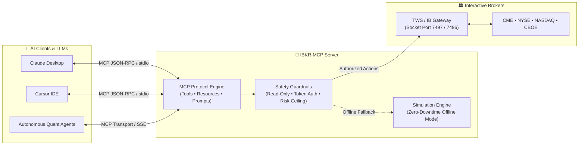
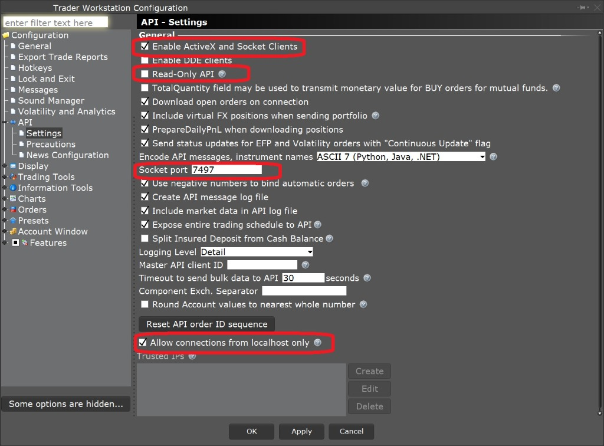
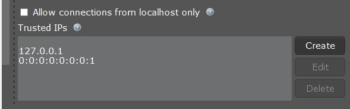

# 🔌 IBKR-MCP — Model Context Protocol Server for Interactive Brokers

[](https://python.org)
[](https://modelcontextprotocol.io)
[](https://interactivebrokers.com)
[](https://claude.ai)
[](https://cursor.com)
[](https://opensource.org/licenses/MIT)

> An institutional-grade **Model Context Protocol (MCP)** server connecting **Claude Desktop, Cursor IDE, Antigravity, and autonomous AI agents** directly to **Interactive Brokers (TWS & IB Gateway)**. Query account balances, stream real-time quotes, inspect 0DTE options chains, preview margin requirements, and execute paper trades with strict **Human-in-the-Loop** safety guardrails.

---

### 💼 Need Custom Quantitative Systems, Trading Bots, or Broker Integrations?
I engineer high-performance algorithmic execution engines, institutional broker APIs, and AI quantitative assistants for funds, prop traders, and private desks.
* 💬 **Telegram:** [@JanzebBlockdev](https://t.me/JanzebBlockdev)
* 💼 **Fiverr Profile:** [Verified Quantitative Developer (Fiverr)](https://tinyurl.com/2wruxnsx)
* 📧 **Email:** `jahanzaibchanna70@gmail.com`

---

## 🏗️ System Architecture



---

## ⚡ Core Capabilities

1. **🛡️ Institutional Safety Guardrails (Human-in-the-Loop)**
   * **Read-Only by Default:** Read operations (`get_account_summary`, `get_market_quote`) are always accessible; order placement requires explicit opt-in.
   * **No Unintended Live Orders:** Hard prohibition on live account execution unless `ALLOW_LIVE_TRADING=true`.
   * **Explicit Confirmation Token:** Orders require `confirm=True` flag to prevent hallucinated trades.
   * **Max Capital Ceilings:** Orders exceeding `MAX_ORDER_VALUE_USD` are automatically intercepted.

2. **📊 Real-Time Account & Portfolio Intelligence**
   * Instant lookup of Net Liquidation Value, Total Cash, Available Funds, and Buying Power.
   * Full position tracking across Equities, Options, and Futures with real-time unrealized PnL.

3. **📈 Multi-Asset Quotes & Level 1 Market Data**
   * Real-time Bid, Ask, Last, Volume, High, Low, and VWAP for US Equities, ETFs, and Index Futures (`ES`, `NQ`, `MES`).

4. **🧮 Options Chain & Greeks Analytics**
   * ATM Implied Volatility (IV), IV Rank, Delta, Gamma, Theta, Vega, and Open Interest.

5. **📝 Pre-Flight Order Preview**
   * Calculates notional value, margin requirement, and estimated commissions *before* submitting any order.

6. **🧪 Seamless Simulation Fallback**
   * Test prompts and tool-calling flows out-of-the-box even on weekends or when TWS is closed.

---

## 🛠️ Interactive Brokers TWS API Setup

To connect IBKR-MCP to your Trader Workstation (TWS) or IB Gateway, configure these settings:

<p align="center">
  
</p>

### Required Settings in TWS:
1. Open TWS **Global Configuration** `->` **API** `->` **Settings**.
2. Check **Enable ActiveX and Socket Clients**.
3. **Uncheck** `Read-Only API` (if you wish to allow paper order execution).
4. Set **Socket port**:
   * `7497` for **TWS Paper Trading** *(Recommended)*
   * `7496` for **TWS Live Trading**
   * `4002` for **IB Gateway Paper Trading**
   * `4001` for **IB Gateway Live Trading**
5. Verify **Allow connections from localhost only** is checked, or add `127.0.0.1` to **Trusted IPs**:

<p align="center">
  
</p>

---

## 🚀 Quickstart

### 1. Installation

```bash
git clone https://github.com/jahanzaib-codes/IBKR-MCP.git
cd IBKR-MCP
python -m venv .venv

# Windows
.venv\Scripts\activate
# Linux/macOS
source .venv/bin/activate

pip install -r requirements.txt
```

### 2. Configure Environment

Copy the example configuration:
```bash
cp .env.example .env
```

Edit `.env`:
```ini
IBKR_HOST=127.0.0.1
IBKR_PORT=7497               # 7497 = TWS Paper
IBKR_CLIENT_ID=42
IBKR_READ_ONLY=true          # Set false to enable paper executions
MAX_ORDER_VALUE_USD=10000.0  # Risk ceiling
ALLOW_LIVE_TRADING=false     # Enforce paper trading only
```

---

## 🤖 Client Integrations

### 1. Claude Desktop Configuration

Add the server to your `claude_desktop_config.json`:

* **Windows:** `%APPDATA%\Claude\claude_desktop_config.json`
* **macOS:** `~/Library/Application Support/Claude/claude_desktop_config.json`

```json
{
  "mcpServers": {
    "ibkr": {
      "command": "python",
      "args": [
        "c:/Users/Jahanzaib/Desktop/Tauric Reserch/IBKR-MCP/server.py"
      ],
      "env": {
        "IBKR_HOST": "127.0.0.1",
        "IBKR_PORT": "7497",
        "IBKR_READ_ONLY": "true"
      }
    }
  }
}
```

### 2. Cursor IDE Integration

In Cursor, go to **Settings** `->` **Features** `->` **MCP**:
1. Click **+ Add New MCP Server**.
2. Name: `ibkr`
3. Type: `command`
4. Command: `python <ABSOLUTE_PATH_TO_IBKR-MCP>/server.py`

---

## 🧰 MCP Tool Specifications

| Tool Name | Parameters | Description |
| :--- | :--- | :--- |
| `get_system_health` | `None` | Verifies TWS socket connection, latency, port status (7497), and safety guardrails. |
| `get_account_summary` | `account_id?` | Retrieves Net Liquidation, Cash, Buying Power, Realized/Unrealized PnL. |
| `list_portfolio_positions` | `account_id?` | Returns all open Equities, Options, and Futures positions with average cost. |
| `get_market_quote` | `symbol`, `sec_type`, `exchange` | Fetches real-time Bid, Ask, Last, Volume, and VWAP. |
| `get_options_chain` | `symbol`, `target_strike?` | Retrieves IV Rank, ATM IV, Delta, Gamma, Theta, and Vega. |
| `preview_order` | `symbol`, `action`, `quantity`, `order_type`, `limit_price?` | Pre-calculates margin impact, commissions, and risk checks before order submission. |
| `place_paper_order` | `symbol`, `action`, `quantity`, `order_type`, `limit_price?`, `confirm` | Submits paper order with safety verification (`confirm=True` mandatory). |
| `cancel_order` | `order_id`, `confirm` | Cancels active order with confirmation. |
| `get_open_orders` | `None` | Lists all working, submitted, and partially filled orders. |

---

## 📑 MCP Resources & Prompts

### Resources
* `ibkr://account/summary` — Real-time stream of account equity.
* `ibkr://portfolio/positions` — Active portfolio holdings.
* `ibkr://system/diagnostics` — TWS socket connectivity metrics.

### Prompts
* `portfolio_risk_review` — Directs the LLM to analyze portfolio concentration, margin cushion, and sector risk.
* `trade_idea_evaluation` — Guides the LLM to inspect market quotes, evaluate options Greeks, and run pre-flight previews.
* `premarket_briefing` — Daily morning briefing summarizing futures levels and overnight risk.

---

## 💬 Example Agent Conversations

```
User: "What's my buying power in Interactive Brokers and do I have any open SPY positions?"
Claude: [Calls get_account_summary & list_portfolio_positions]
"Your current Net Liquidation Value is $125,480.50 with $250,961.00 in Buying Power.
You currently hold 100 shares of SPY at an average cost of $585.20 (Unrealized PnL: +$720.00)."

User: "Preview buying 10 shares of NVDA at market price."
Claude: [Calls preview_order(symbol="NVDA", action="BUY", quantity=10)]
"Trade Preview:
• Notional Value: $1,442.00
• Estimated Commission: $1.00
• Initial Margin Requirement: $360.50
• Risk Status: APPROVED (Under $10,000 threshold)
Would you like me to submit this paper order? Please confirm."
```

---

## 📄 License

Distributed under the **MIT License**. See `LICENSE` for details.

---

### 🌟 Maintained by **Jahanzaib**
* **GitHub:** [@jahanzaib-codes](https://github.com/jahanzaib-codes)
* **Fiverr:** [Hire for Quant & Trading Bot Development](https://tinyurl.com/2wruxnsx)
* **Telegram:** [@JanzebBlockdev](https://t.me/JanzebBlockdev)
* **Email:** `jahanzaibchanna70@gmail.com`

